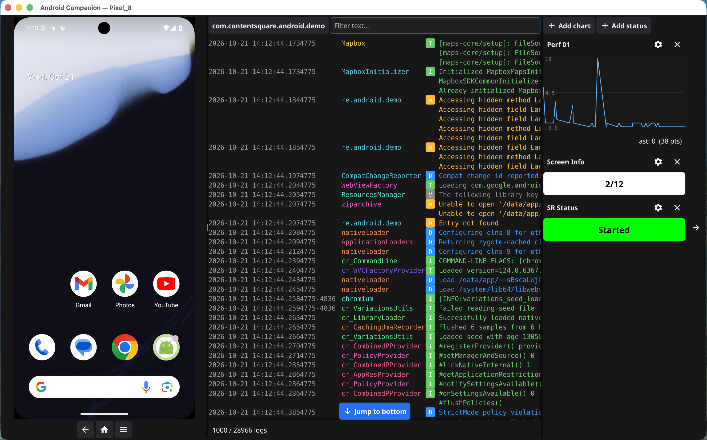

# Android Companion

A desktop app that launches an Android emulator **embedded inside the window**, or connects to a **physical device over USB or Wi-Fi**, with a live **logcat** panel and a **plugin system** for log-driven widgets (line charts, status badges).

Built with **Go + Fyne** and the emulator's **gRPC bridge** (the same mechanism Android Studio uses to embed the emulator).



## Features

### Devices

- Picker with the connected devices (USB, Wi-Fi, running emulators) and the AVDs to launch; it refreshes as devices come and go
- Pair a device over Wi-Fi with a pairing code (Android 11+), or `adb connect` to it
- Physical devices get logs and plugins; screen mirroring is only available for emulators
- If the device disconnects, the app goes back to the picker and keeps its logs
- Pass `-avd <name>` or `-serial <serial>` to skip the picker

### Emulator

- Click, tap and drag directly on the emulator screen
- On-screen back / home / recents buttons
- Stop button, back to the picker; closing the window also kills the emulator

### Logcat

- Android Studio look: aligned columns, colored tags and severity levels
- Multi-line messages
- Package picker plus free-text filter: space-separated terms that must all match, `~term` hides lines containing `term`, `"a phrase"` keeps spaces, `\~` for a literal `~` (e.g. `error ~Choreographer ~gc`)
- The last package and filter are restored on the next start
- Auto-scroll that stops when you scroll up and resumes with a jump-to-bottom button
- Horizontal scrolling for long lines
- The log keeps up even on chatty apps: only visible rows are rendered

### Plugins

Widgets driven by log lines, in a collapsible right column. Add, edit and remove them; configs persist across restarts.

**Line chart** — plot a value extracted from matching lines in real time:

```
pattern: frame took {%d}ms
```

`{%d}` captures an integer, `{%f}` a decimal, `{%s}` a word.

**Status badge** — a colored badge that reflects the last matching rule:

```
rule 1: "player started"  -> Playing (green)
rule 2: "player paused"   -> Paused  (amber)
```

Captured values can be shown in the label:

```
pattern: buffering at {%d}%
label:   Buffering $0%     -> badge shows "Buffering 42%"
```

## Requirements

- Go 1.22+
- `adb`, from the Android SDK platform-tools (`ANDROID_HOME` respected) or in `PATH`
- To launch emulators: the Android Emulator SDK package and at least one AVD
- **Linux**: `sudo apt install libgl1-mesa-dev xorg-dev`
- **macOS**: no extra deps
- For regenerating protobufs: `protoc`, `protoc-gen-go`, `protoc-gen-go-grpc`

## Build & Run

```sh
make build
./android-companion                         # in-app picker
./android-companion -avd Pixel_8            # launch an AVD, skip picker
./android-companion -avd Pixel_8 -wipe      # cold boot with data wipe
./android-companion -serial 11041FDD4002MQ  # open a connected device (see `adb devices`)
```

Run tests:

```sh
go test ./...
```

## Project layout

- `internal/adb` — device list, device info, Wi-Fi pairing
- `internal/avd` — SDK discovery, AVD list, emulator process
- `internal/emulator` — gRPC client for the emulator controller
- `internal/logcat` — `adb logcat` parser and in-memory store
- `internal/plugin` — plugin interface, registry, pattern compiler, persistence (`chart`, `status`)
- `internal/ui` — the widgets
- `internal/app` — wiring and lifecycle

## Regenerating protobuf bindings

```sh
make proto
```

The proto file is copied from `$ANDROID_HOME/emulator/lib/emulator_controller.proto`.

## Cross-compilation

Fyne uses cgo, so native builds per OS are simplest:

```sh
# On Linux
GOOS=linux go build -o android-companion-linux .

# On macOS
GOOS=darwin go build -o android-companion-darwin .
```

---

Made with ❤️ by Ricardo Markiewicz // [@gazeria](https://x.com/gazeria)
